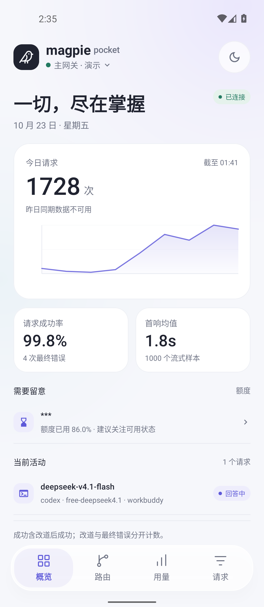
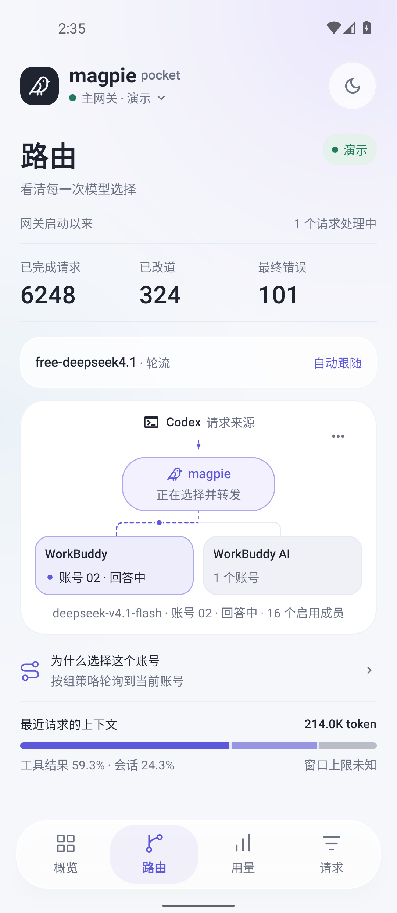
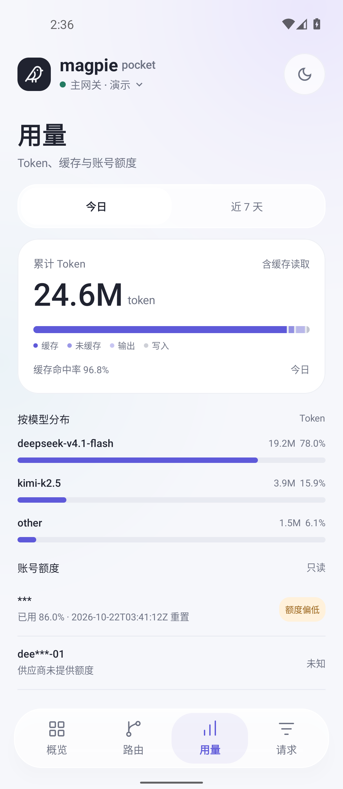
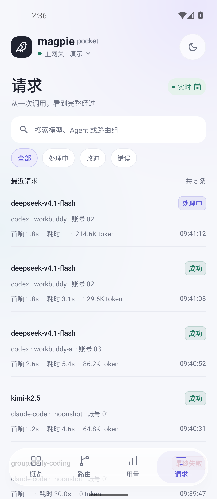
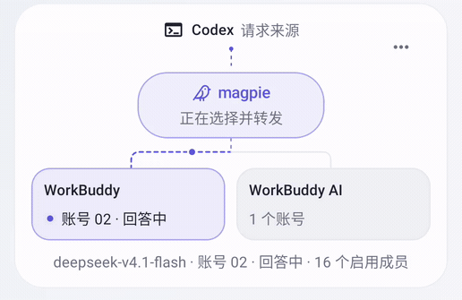
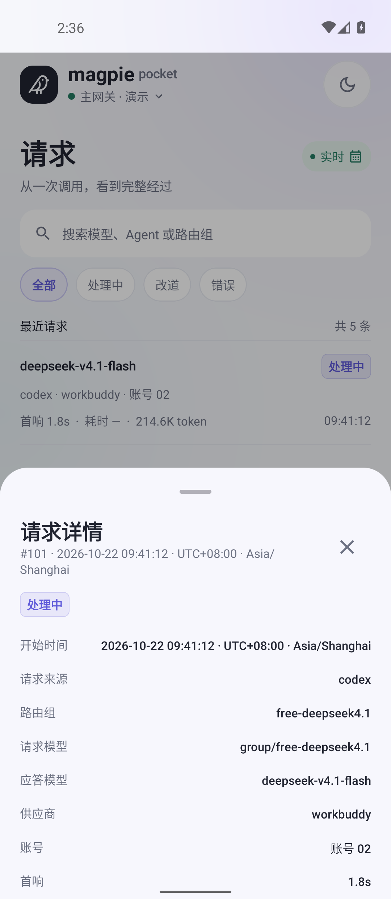
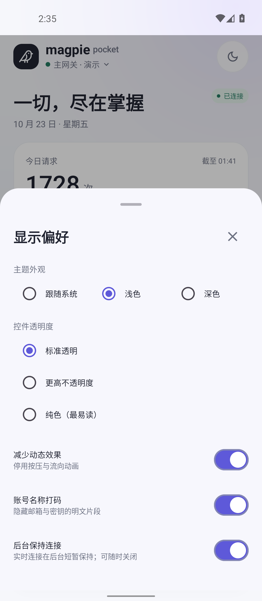
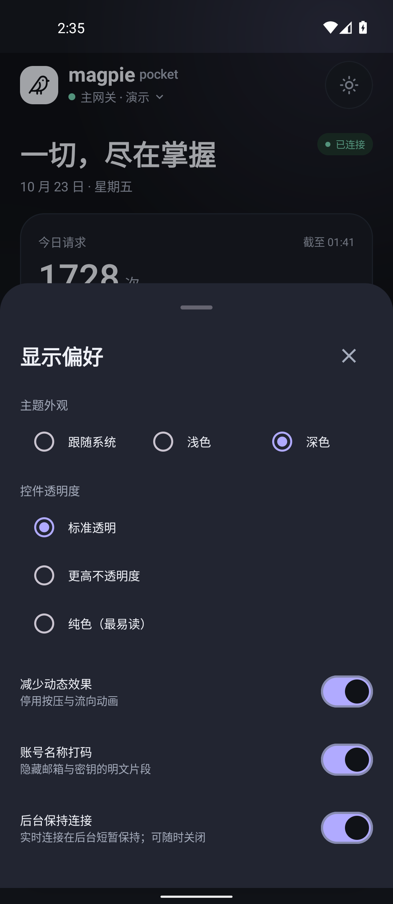

<p align="center">
  
</p>

# Magpie Pocket

[](https://developer.android.com)
[](https://kotlinlang.org)
[](https://developer.android.com/jetpack/compose)
[](LICENSE)

[中文](#中文) · [English](#english) · [接入说明](docs/integration.md) · [验证记录](docs/verification.md) · [设计 Skill](.agents/skills/magpie-pocket-design/SKILL.md)

**[下载 v1.0.2 APK · Download](https://github.com/CottonChou/magpie-pocket/releases/download/v1.0.2/magpie-pocket-v1.0.2.apk)**（Android 7.0+） · [发布说明 / Release notes](https://github.com/CottonChou/magpie-pocket/releases/tag/v1.0.2) · [设计 Skill ZIP](https://github.com/CottonChou/magpie-pocket/releases/download/v1.0.2/magpie-pocket-design.zip)

v1.0.1 起使用新的发布签名；v1.0.0 及更早版本需卸载后重装，连接与偏好会清除。v1.0.1 → v1.0.2 保持相同签名，可直接覆盖升级。详见[升级说明](docs/integration.md#v101-安装与签名变更)。

v1.0.1 introduced a new signing certificate. Versions 1.0.0 and earlier require uninstall/reinstall, which clears saved data. Version 1.0.2 retains the v1.0.1 certificate and supports in-place upgrades.

## 中文

[Magpie](https://github.com/yetone/magpie) AI 网关的原生 Android 观测客户端。采用 Kotlin、Jetpack Compose 和轻透玻璃风格，提供概览、实时路由、用量与请求账本四个页面。首期聚焦只读观测；路由组由实际请求自动跟随，不需要手动选择。

### 页面预览

以下为 **Android 11 模拟器中的实际应用截图**，全部使用应用内标注的演示数据，账号显示为别名。

<table>
  <tr>
    <th>概览 · Overview</th>
    <th>实时路由 · Routing</th>
    <th>用量 · Usage</th>
    <th>请求 · Requests</th>
  </tr>
  <tr>
    <td></td>
    <td></td>
    <td></td>
    <td></td>
  </tr>
</table>

**路由动效**：处理中沿实际选中的路径流动，账号状态随请求更新；完成后停止流动。演示录屏用于展示效果，真实连接时由服务端 trace 驱动。



**请求明细**：完整本地时间、UTC 偏移、时区，以及模型、账号和尝试经过。



**显示偏好**：浅色使用白色圆点，深色使用深色圆点；开启后仍与轨道清晰分离。

 

### 能力

- **概览**：今日请求、错误、首响均值、小时趋势和额度信息。
- **实时路由**：自动跟随全局最新处理中请求及其实际路由组，显示实际供应商、账号、改道尝试、选路依据与上下文构成；历史查看保持固定，支持返回实时。
- **用量**：今日 / 近 7 天、输入 / 输出 / 缓存 Token、加权缓存命中率、模型分布和账号额度窗口。
- **请求账本**：搜索、状态筛选、请求明细与尝试时间线。RFC3339 时间按手机本地时区显示，支持纳秒、正负时区偏移和跨日。
- **连接认证**：支持 Magpie Web Key / Cookie 会话，以及可选的 Cloudflare Access Service Token。需要两层认证时，两组凭据分别填写；CF Token 不能替代 Magpie Web Key。
- **后台连接**：真实连接默认启用可关闭的常驻通知服务、30 秒轻量心跳与有上限的退避重连。返回前台或网络恢复时重新校验；演示模式不启动后台联网。
- **显示偏好**：浅色 / 深色、三档材质、账号打码与减少动态效果；开关在浅色与深色的开/关状态都有明确的圆点和轨道。系统动画关闭、后台或离线时，路由动画停止。
- **演示模式**：无需服务器即可体验页面；演示与真实连接分开标识。

玻璃效果通过透明色、层级、高光与柔和阴影实现，数据区域优先保证可读性。它是 Android 原生设计实现，不依赖 Apple 系统材质。

### 构建与运行

要求 JDK 17 或 21、Android SDK 34。最低运行版本为 **Android 7.0 / API 24**。

Debug 构建不需要发布密钥。构建 Release 前，将 `signing.properties.example` 复制为 `signing.properties`，填写自己的签名文件及密码；也可以使用 `MAGPIE_KEYSTORE_FILE`、`MAGPIE_KEYSTORE_PASSWORD`、`MAGPIE_KEY_ALIAS`、`MAGPIE_KEY_PASSWORD` 环境变量。真实密钥和本地签名配置均由 Git 忽略；未配置签名时，Release 构建会明确报错。

```bash
git clone https://github.com/CottonChou/magpie-pocket.git
cd magpie-pocket

# 测试与代码检查
./gradlew :app:testDebugUnitTest :app:lintDebug

# 构建 APK
./gradlew :app:assembleDebug :app:assembleRelease
```

产物位于 `app/build/outputs/apk/debug/app-debug.apk` 和 `app/build/outputs/apk/release/app-release.apk`。

启动后可先使用演示模式，也可从左上角网关入口配置管理服务地址与认证信息。地址应指向 **Magpie 管理服务**，不是 `/v1` 模型推理接口。连接探测成功后才保存配置。

### 当前验证

- **140 项单元测试通过**，无失败、错误或跳过。
- **Android 11 / 14 原生验证通过**，覆盖后台心跳、故障恢复、自动路由、冷启动、动效、开关状态及正式包升级；具体范围见验证记录。
- Debug / Release 构建成功；Lint 无错误；正式 APK v2 / v3 签名验证通过。

接口能力由实际探测决定；缺失的数据保留为空，不用估算值补造。历史查询范围和详情保留期取决于服务端。具体范围见[验证记录](docs/verification.md)。

## English

**Magpie Pocket** is a native Android observability client for the [Magpie AI gateway](https://github.com/yetone/magpie), built with Kotlin and Jetpack Compose. It focuses on read-only monitoring with a restrained glass-inspired interface.

The screenshots and animation above are captured from the actual Android app using clearly labeled **Demo data**.

- **Overview**: request statistics, mean TTFT, trends and quota information.
- **Background connection**: optional foreground notification service, a lightweight 30-second heartbeat and reconnect backoff capped at 30 seconds per delay; no live service in Demo mode.
- **Routing**: automatic group selection from the latest live request, trace-driven flow, actual provider/account changes, routing evidence and context breakdown. Inspect historical requests without losing the selection, then return to live following.
- **Usage**: today / seven-day views, token categories, weighted cache hit rate and quota windows.
- **Requests**: search, status filters and attempt details. Timestamps are parsed as instants and rendered in the device timezone, including explicit offsets and nanosecond timestamps.
- **Access**: Magpie Web Key sessions and optional Cloudflare Access service-token headers, with encrypted credential storage.
- **Accessibility**: account masking, light/dark themes and reduced motion. Routing motion also stops when system animations are disabled, the app is backgrounded or the connection is offline.

Requires **Android 7.0+ (API 24)**. Build with JDK 17/21 and Android SDK 34 using the commands above. The interface uses layered tints, highlights and shadows; it does not claim Apple system-material or optical-refraction support.

Debug builds need no release key. For Release builds, copy `signing.properties.example` to the ignored `signing.properties` and supply your own signing credentials, or set the four `MAGPIE_KEYSTORE_*` / `MAGPIE_KEY_*` environment variables listed above. Private signing material must never be committed. Release builds fail explicitly when signing is not configured.

Validation: **140 passing unit tests**, Android 11/14 native checks for background recovery, routing, switches and upgrades, successful Debug/Release builds and no lint errors. See [verification](docs/verification.md), [integration](docs/integration.md) and [design decisions](docs/decisions.md).

## 复用设计 · Reuse the design

项目内置 [$magpie-pocket-design](.agents/skills/magpie-pocket-design/SKILL.md)，包含[详细规范](.agents/skills/magpie-pocket-design/references/design-spec.md)、精确参数和用户确认的参考图。可交给其他 AI 使用，也可将该目录复制到支持 skill 的工具目录中安装。规范明确了自动路由、开关各状态与 Android 原生安全区，不把旧图中的分组下拉照搬回新版。

## License

[MIT](LICENSE). The bird mark adapts Lucide artwork under the ISC license; attribution is retained in [design decisions](docs/decisions.md#bird-artwork-attribution).
